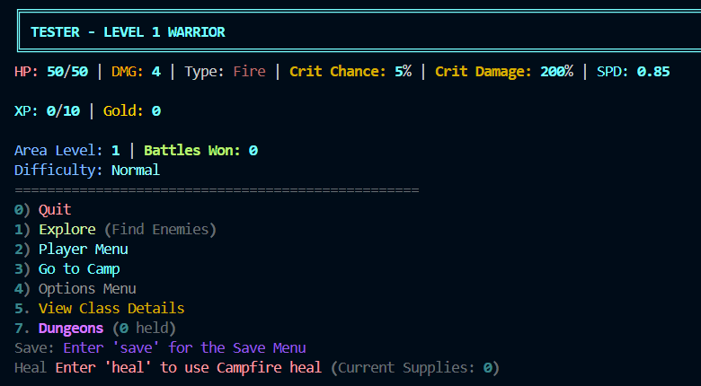
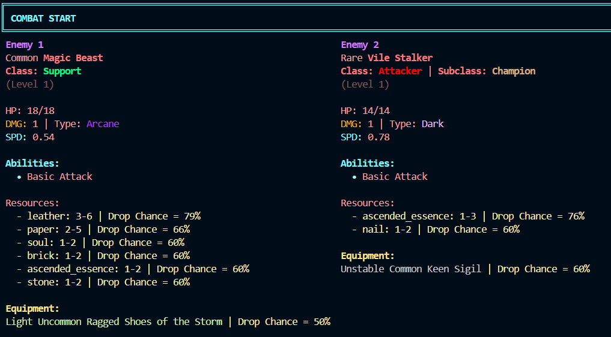
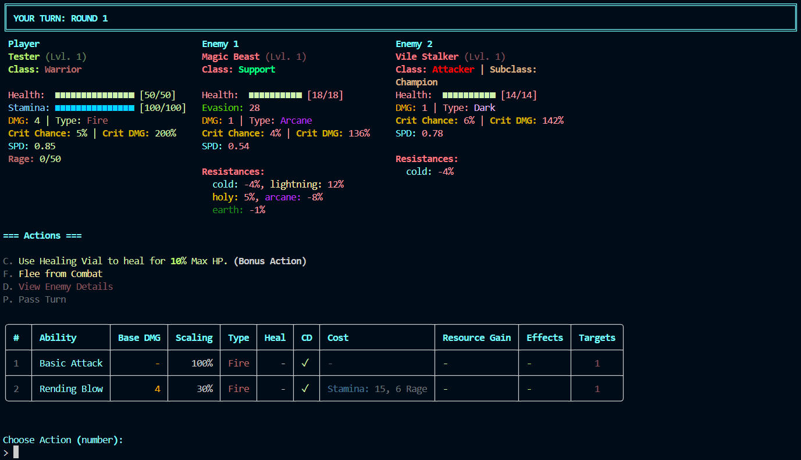
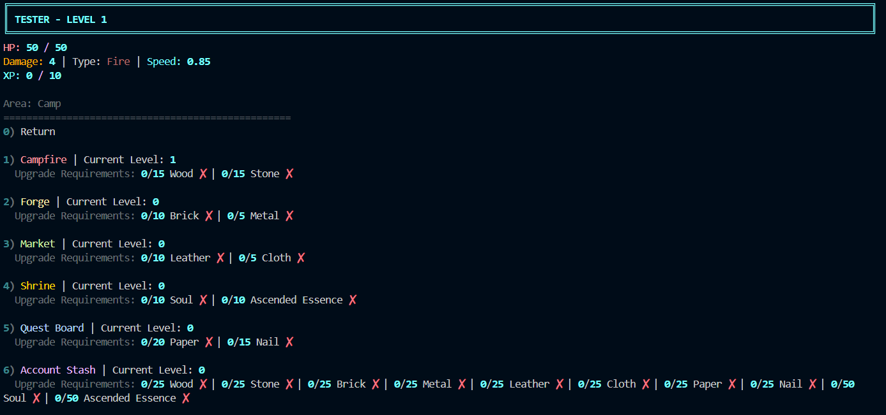

# Korus

**A terminal-based, turn-based RPG with a deep itemisation and crafting system, built in Python with native Rust tooling.**

Korus is a single-player, text-driven roguelite in the vein of *Path of Exile* and *Slay the Spire*. You pick one of eleven classes, fight escalating groups of enemies, loot procedurally generated equipment, and use a rune-based crafting system to build a character around the affixes you find. The game runs entirely in the terminal and uses [Rich](https://github.com/Textualize/rich) for its interface.

The project is roughly 28,000 lines of Python. It also includes three small Rust programs and a Go build helper. I built it to practise designing large, data-driven systems, not just to ship a game.

---

## Features

### Combat
- Turn-based combat against groups of 2–8 enemies, with turn order set by speed.
- Enemies have rarities, classes (attacker/support) and subclasses, stamina costs for abilities, and affixes that raise both difficulty and loot.
- Enemy decisions come from a native Rust AI. Python sends it a JSON snapshot of the battle, and it scores candidate actions with a short lookahead. It is a separate process.
- Players also have a bonus-action consumable and can eat food for temporary buffs.

### Classes and ascendancies
Eleven base classes, each with its own resource mechanic, for example Fighter stances, Cultist insanity, Paladin favour, Warrior rage and Mage adaptations. Each class has 5–6 ascendancies, about 57 in total, which change how the class plays.

| | |
|---|---|
| Cultist | Druid |
| Fighter | Mage |
| Marauder | Paladin |
| Spectre | Tempest |
| Wanderer | Warrior |
| Wretch | |

### Itemisation and crafting
- Equipment is procedurally generated across nine slots (weapon, armour, rings, amulet, offhand, sigils). Items have a base type, implicits, tiered prefix and suffix affixes, rarities, durability and entropy.
- Special affix pools include mythic, soulbound and market-exclusive affixes, with plans to include more.
- Crafting uses runes, grouped into families: chaos, erasing, growth, randomiser, manipulation, mastery, rarity, destabilisation, revealing, quest and unique. The Forge can also repair, vaporise and foresight-preview crafts.
- Item and affix definitions are JSON, so most content can change without touching the engine.

### Camp and progression
Between fights you return to a camp with upgradeable stations:

| Station | Purpose |
|---|---|
| Campfire | Healing, cooking food, emergency revivals |
| Forge | Crafting, repair, vaporising equipment | Note: Vaporising = destroying a piece of equipment and getting crafting runes in return
| Market | Buying gear and runes, resource conversion, special commissions, a black market |
| Quest Board | Milestones and bounties, plus a unique rune shop |
| Shrine | Permanent blessings |
| Account Stash | Storage shared across every character on an account |

### Dungeons
Defeated enemies can drop dungeon maps. Running one generates a node graph of rooms (combat, elite, rest, merchant, treasure, event, boss) with map modifiers that change the rules for the run.

### Systems around the game
- Accounts and saves. Saves are namespaced per account. Hardcore mode permanently deletes a save on death. There is also an undo-last-operation feature.
- Difficulty tiers. Easy, Normal, Hard, Nightmare and Hell.
- In-game help and a tutorial. Both are reachable from the menus.
- Optional web feed. If a companion server is running on `localhost:8080`, the game posts every generated item and each saved character to it in a background thread. If the server is down, nothing changes in play.

---

## Architecture

```
main.py                  Game loop, menus, combat orchestration
scripts/
  player.py, entities.py   Shared entity model, stats, equipment slots
  player_classes/          One module per class + ascendancies
  combat.py                Turn manager and ability resolution
  abilities.py             Data-driven ability and effect system
  enemies/                 Enemy generation, affixes, Rust-AI bridge
  items/                   Equipment, affix, food, mythic/soulbound logic
    data/*.json            Affix pools, base types, mythic/soulbound data
  crafting/                One module per rune family
  campAreas/               Campfire, forge, market, quest board, shrine, stash
  dungeons/                Map graph, rooms, bosses, modifiers
  files.py, accounts.py    Save/load, accounts, crash logging
native/                  Rust crates (see below)
tools/                   Compiled binaries + Go build helper
tests/                   pytest suites and automated playthroughs
```

**Design notes**

- Data-driven content. Affixes, abilities, enemy skills, quests and dungeon modifiers live in JSON. Code handles generation and resolution.
- Polyglot by purpose. Rust is used where an isolated, fast, type-checked process is useful, and Python stays in charge of game logic.
- Fail-soft integrations. Native helpers and the web feed are optional at runtime. If one is missing, the game falls back to a simpler behaviour instead of crashing, for example saving plain JSON when the save codec is unavailable.

### Native components (`native/`)

| Crate | Role |
|---|---|
| `korus_enemy_ai` | Reads a combat snapshot as JSON on stdin and prints one chosen action per enemy. It scores actions and does a bounded lookahead. |
| `korus_save` | Encodes and decodes the compressed `.korus` save format (`--encode` / `--decode`). |
| `korus_watch` | Background file watcher that logs changes to the saves folder. |

`tools/korus-build` is a small Go program that finds every crate under `native/`, builds it in release mode and copies the binary into `tools/`.

---

## Getting started

### Requirements

- **Windows.** The bundled helper binaries are `.exe` files, and the game launches the save watcher at startup.
- **Python 3.10 or newer.** The code uses `match` statements. It was developed on Python 3.14.
- **Rich:** `pip install rich`
- *Optional:* [Rust](https://rustup.rs) (and [Go](https://go.dev), if you want the build helper) to rebuild the native binaries. Prebuilt binaries are already in `tools/`.

### Run the game

```powershell
git clone https://github.com/HuzaifaSM/Korus
cd Korus
pip install rich
python main.py
```

On first launch you create an **account**, then choose **New Game** and pick a class. The in-game **Tutorial** option on the title screen covers the basics. `Options Menu → Help Menu` has deeper documentation on every system.

**Useful commands at the main menu**

| Input | Action |
|---|---|
| `1` | Explore (find enemies) |
| `2` | Player menu (resources, runes, equipment, abilities) |
| `3` | Go to camp |
| `7` | Dungeons |
| `save` | Open the save menu |
| `heal` | Use a campfire heal (once the campfire is built) |

### Rebuilding the native tools (optional)

```powershell
# everything, via the Go helper
cd tools/korus-build
go run . -path ../..

# or a single crate, straight from the project root
cargo build --manifest-path native/korus_enemy_ai/Cargo.toml --release
```

Copy the built binary from `native/<crate>/target/release/` into `tools/` if you build by hand. The Go helper does this for you. Use `-only korus_enemy_ai,korus_save` to build a subset.

### Optional: web item feed

If a compatible server is listening on `http://localhost:8080` (health check at `/health`), the game sends it items and player snapshots at `/api/items` and `/api/players`. The server is a separate project and is not included in this repository. Without it the game runs as normal.

---

## Testing

```powershell
pip install pytest
python -m pytest tests
```

The test folder holds unit tests for abilities and ascendancy behaviour, plus automated playthroughs that drive real characters through combat and levelling. These are used to check balance and catch crashes. `auto_playthrough.py` runs one from the command line:

```powershell
python auto_playthrough.py --target-class=Warrior
python auto_playthrough.py --target-class=Paladin --ascendancy=Zealot
```

`crafting_sandbox.py` is an interactive tool for creating test items and applying runes, to experiment with the crafting system in isolation.

---

## Project status

Korus is under active development. Dungeons are the current focus, covering more modifiers, event rooms and pre-generated encounter lists. A twelfth class is also in progress. Saves are not guaranteed to be compatible between versions while the systems are still changing.

## Gameplay Images









## Author

**Sheikh Muhammad Huzaifa**
